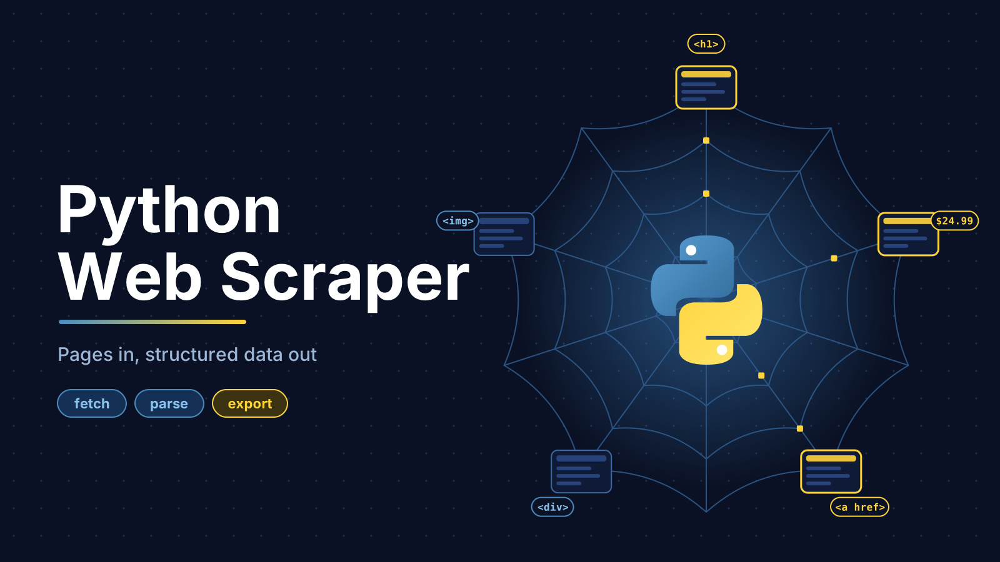
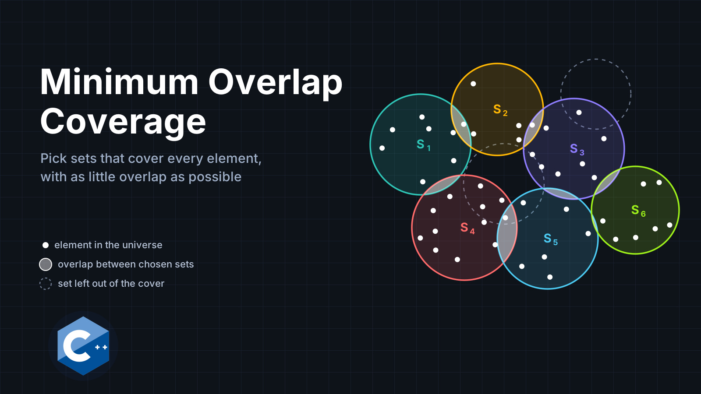
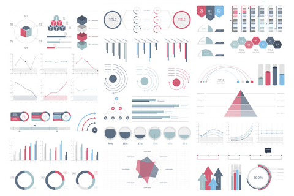
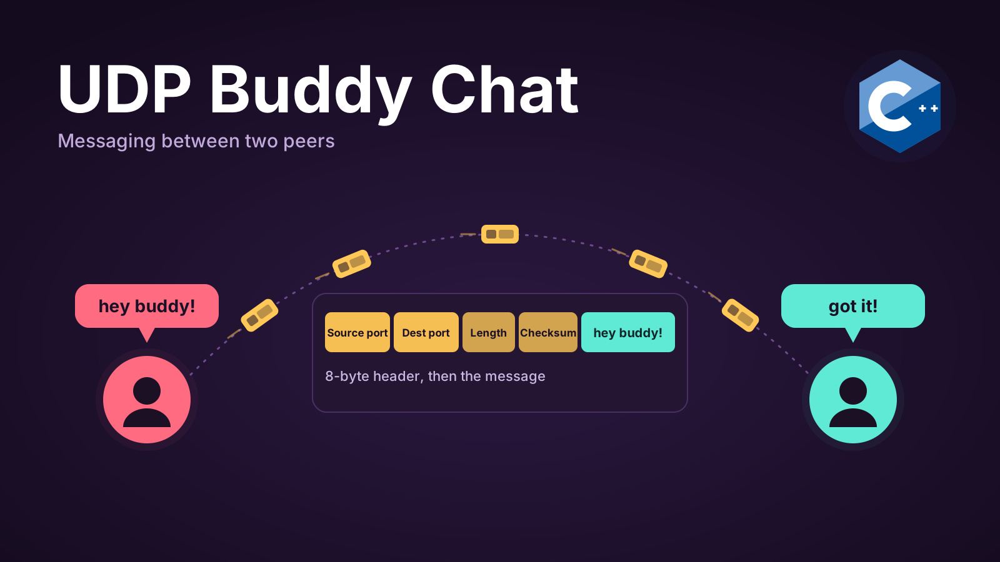

Portfolio
=========

Programming Projects
--------------------

*For access to my private project repositories, please [email me](mailto:SMMorgan@student.csuniv.edu?subject=GitHub%20Access) with the subject line, GitHub Access.

---
### [Python Web Scraper | CSCI 301](project1)

---
### [Minimum Overlap Coverage | CSCI 315](project1)

---
### [Journey to Cura | CSCI 325](project1)

---
### [UDP Buddy Chat | CSCI 332](project1)

---

Ethics Papers
-------------

### [The Ethics of Automatic Software Testing](/pdf/AutoSoftware.pdf)

-   **Class:** Data Structure Analysis
-   **Grade:** A

### [The Ethics of Privacy and Data Handling in Computer Science](/pdf/dataProtection.pdf)

-   **Class:** Object Oriented Programming
-   **Grade:** A

### [The Ethics of Artificial Intelligence](/pdf/AI.pdf)

-   **Class:** Survey of Scripting Languages
-   **Grade:** A

---

Presentations
-------------

### [Presentation 1 Title](/pdf/sample_presentation.pdf)

- **Class:** 
- **Grade:**

### [Presentation 2 Title](/pdf/sample_presentation.pdf)

- **Class:** 
- **Grade:**

---

Page template forked from <a href="https://github.com/csu-cs/csci-portfolio">CSU-CS</a>

<!-- Remove above link if you don't want to attributive -->
