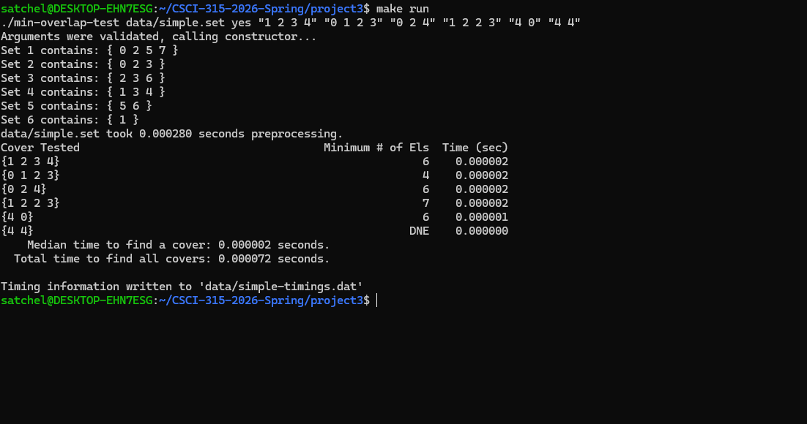
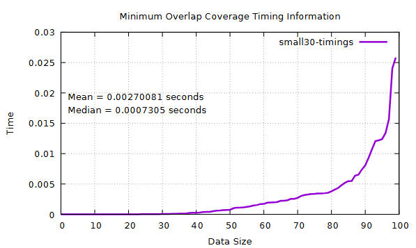

[Back to Portfolio](./)

Minimum Coverage Overlap
===============

-   **Class:** Data Structure Analysis
-   **Grade:** A
-   **Language(s):** C++ 
-   **Source Code Repository:** [Data Structures](https://github.com/Satchmmorgan/CSCI-315-2026-Spring.git)  
    (Please [email me](mailto:SMMorgan@student.csuniv.edu?subject=GitHub%20Access) to request access.)

## Project description

This project was made as a proposed solution to the Computer Science "Set-Cover" problem. The program is designed to test multiple data sets of varying sizes to find the most efficient union of sets to cover the proposed coverage set. Furthermore, the program also contains the necessary tools to analyze the time complexity of the algorithm, and output the data in a format that can be graphed via GNUplot.

## How to compile and run the program

The project itself includes a makefile to automate compilation flags. To run this program, you will need to have installed Make, GNUplot, and a c++ compiler (originally compiled and ran with g++).

1. Install the c++ compiler and gnuplot.

2. Navigate to the projects directory, and run with the following commands

```bash
make run
make small-timings
```

3. After the timings are ran, the plot should open within your VScode. If not, it can be viewed with
   
```bash
code data/small30-timings.pdf
```


## UI Design
This program is made using a Command Line Interface, and all arguments are passed through the terminal. However, the program also features visualization using created graphs that plot the timing information as the size of the data increases.


Fig 1. The output of a regular run of the program

  
Fig 2. The plotted graph of the small timings.

## 3. Additional Considerations

Timing information will vary from system to system, due to differences in processing power, memory, etc.

[Back to Portfolio](./)
