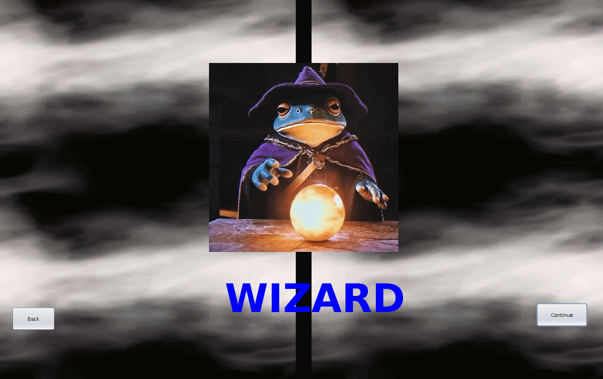
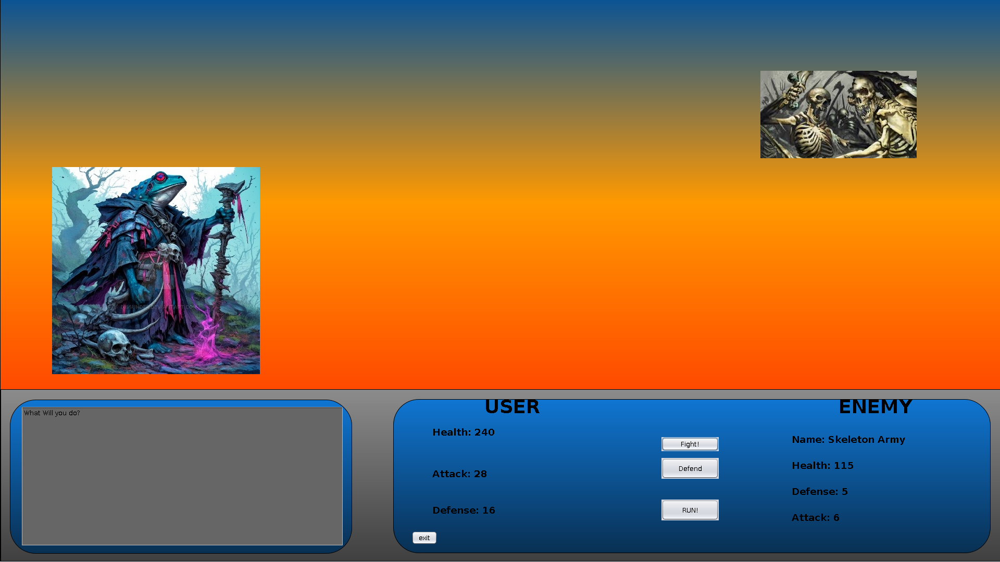

[Back to Portfolio](./)

The Journey to Cura
===============

-   **Class:** Object Oriented Programming
-   **Grade:** A
-   **Language(s):** Java 
-   **Source Code Repository:** [TeamRocket](https://github.com/csu-cs/csci325_TeamRocket.git)  
    (Please [email me](mailto:example@csustudent.net?subject=GitHub%20Access) to request access.)

## Project description

This project is a turn based role playing game, inspired by many classic Japanese Role Playing Games that inspired me to begin programming. The game is story driven, and features in game battles along with choices that will affect the overall outcome depending on if your choices align you more towards good, bad, or neutral. 

The games battle system features choices as well, which encourages strategy from the player to navigate battles to continue on with the story. The user can choose to attack, defend, or run on their turn, each of which can have their own advantages or disadvantages.

My contribution to this project was the story and the alignment system, along with helping create some of the assets for the GUI interface viewed by the user.

## How to compile and run the program
The source repository has a complied jar file, and can be run with the following command on a system with java 25 installed.

```bash
java -jar FinalProject.jar
```

## UI Design

The game features a Graphical User Interface that users will interact with by selecting options presented to them on the screen. The user will select their story choices, battle decisions, and character choices all from the displayed GUI. The interface displays the users stats, battle information, and the story text to the user.

  
Fig 1. The character select screen

  
Fig 2. In game view of a battle

[Back to Portfolio](./)
