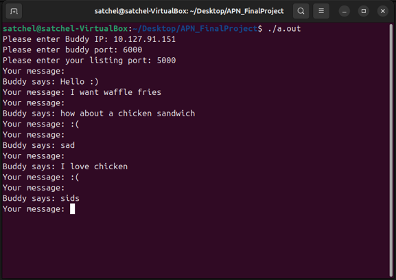

[Back to Portfolio](./)

UDP Buddy Chat
===============

-   **Class:** Applied Networking
-   **Grade:** A
-   **Language(s):** C++ 
-   **Source Code Repository:** [Buddy Chat](https://github.com/Satchmmorgan/APN_2026.git)  
    (Please [email me](mailto:SMMorgan@student.csuniv.edu?subject=GitHub%20Access) to request access.)

## Project description

This project is a chat application used to allow communication between two connected devices on a shared network. The program uses sockets from UDP to ensure connection between the devices and to transmit the typed messages. Separate server threads are also opened and ran by the program to allow receiving input and sending output from a singular device. 

## How to compile and run the program

Running this project will require a C++ complier (g++ was used originally), and can be compiled and ran with the following commands. 

```bash
g++ buddy.cpp -o chat
./chat
```

## UI Design

This program is ran with a Command Line Interface, so messages are both sent and received straight from the terminal. Users will be asked for information including the desired "buddy" computers IP and port.

  
Fig 1. The perspective of one computer during a chat.

  
Fig 2. The same chat from the second computers perspective.

## 3. Additional Considerations

The system that you will be communicating with needs to be on the same network for this to function as intended. Likewise, you will need to know the IP address of both systems.

[Back to Portfolio](./)
